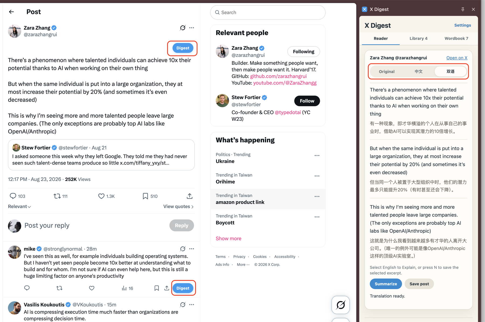
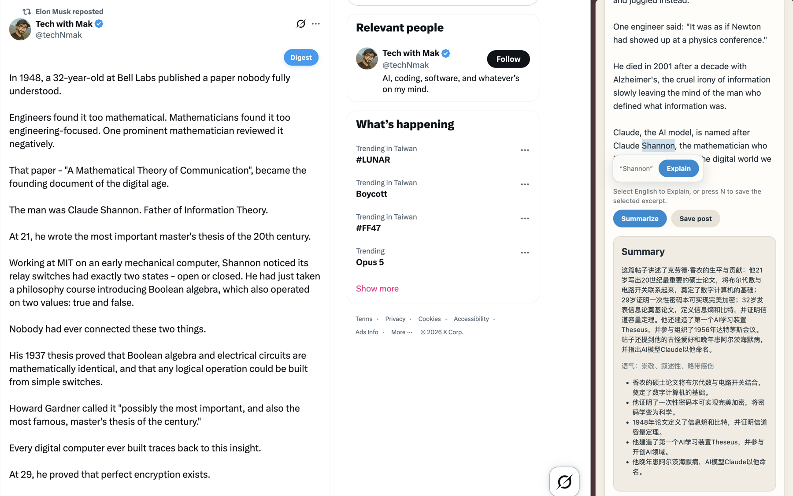
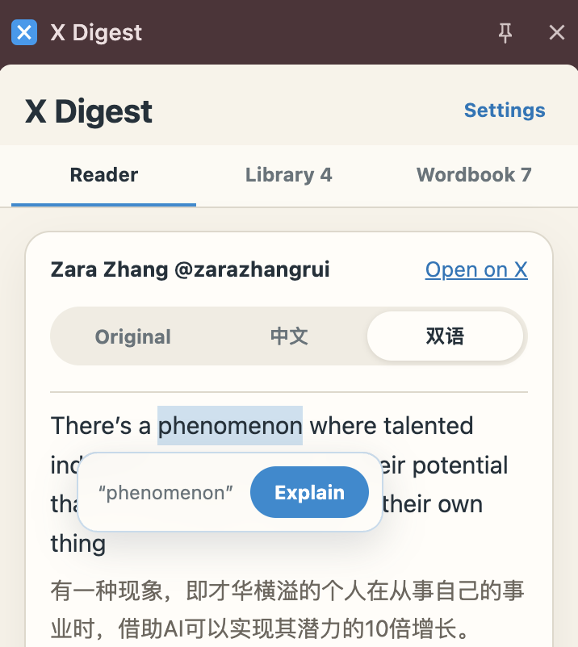
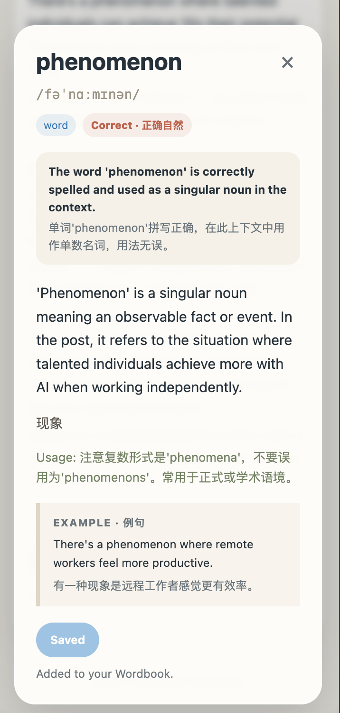
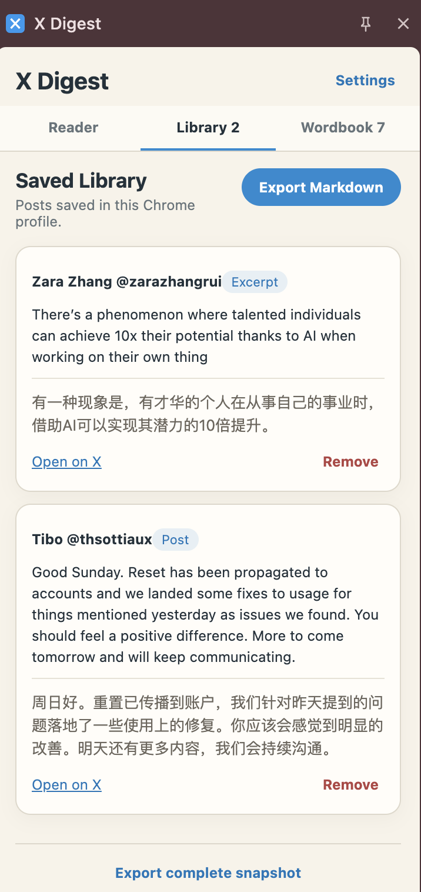
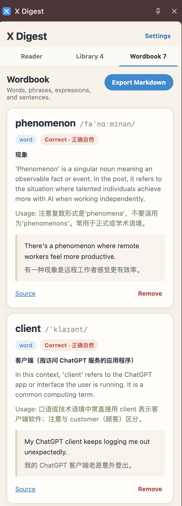
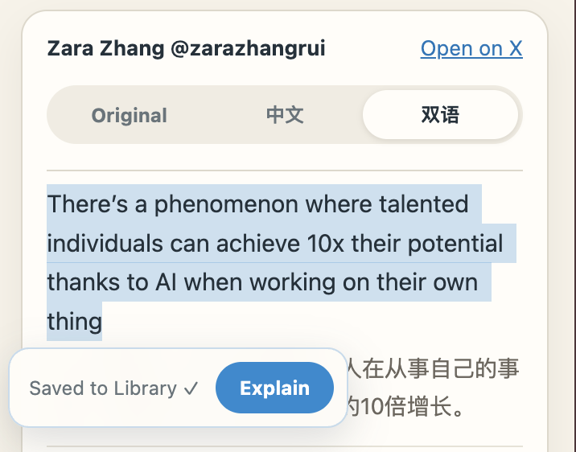

# X Digest

<p align="center"></p>

[English](README.md) · [简体中文](README.zh-CN.md)

**Read X. Keep what matters. Learn the language in context.**

X Digest is a local-first Chrome extension for turning posts you are already reading on X into bilingual reading and English-learning material. Open a post, read an aligned English–Chinese version, summarize a long post, explain an expression in context, or save one useful sentence without collecting your whole timeline.

> **Origin and attribution:** X Digest began as an X-focused remix of [YouTube Digest](https://github.com/zarazhangrui/youtube-digest). Its initial architecture and prompt design were adapted from that MIT-licensed project, and it has since evolved into an independent extension built specifically for X.

## Why X Digest?

X is full of lively, current English—but useful expressions are easy to lose in a fast-moving feed. X Digest keeps the reading experience close to the original post while adding just enough help:

- **Aligned bilingual reading** — English and Chinese appear paragraph by paragraph, not as two disconnected walls of text.
- **Summarize long posts** — get the main idea without losing the original.
- **Explain in context** — select a word or phrase to check naturalness, correction, IPA, meaning, usage, and examples.
- **Save only what matters** — save a whole short post or press `N` to keep just the selected sentence or paragraph.
- **Build a reusable library** — saved posts, excerpts, and wordbook entries stay in the browser and can be exported as Markdown.
- **Bring your own AI key** — AI requests use your DeepSeek API key; X Digest has no application server.

## Current release

This repository is the **P1 public beta (`v0.1.0`)**. The core single-post learning loop has been tested as an unpacked extension on real X home, detail, long-post, and reply views. X changes its page structure frequently, so edge cases may still appear.

The extension is not yet published in the Chrome Web Store. Install it locally from this repository.

See [the roadmap](docs/ROADMAP.md) for the current boundary and P2 ideas.

## Screenshots



<p align="center">
  
  <br><sub>Turn a long post into a concise overview, tone reading, and key points.</sub>
</p>

<table>
  <tr>
    <td width="50%" align="center">
      
      <br><sub>Select a word without leaving the post.</sub>
    </td>
    <td width="50%" align="center">
      
      <br><sub>Check naturalness, IPA, meaning, usage, and an example—then save it.</sub>
    </td>
  </tr>
  <tr>
    <td width="50%" align="center">
      
      <br><sub>Keep a whole post or just the excerpt that matters.</sub>
    </td>
    <td width="50%" align="center">
      
      <br><sub>Turn explanations into a reusable local Wordbook.</sub>
    </td>
  </tr>
</table>

<p align="center">
  
  <br><sub>Select a sentence or paragraph and press <code>N</code> to save it to the Library.</sub>
</p>

## Install

### With a coding agent

You can give Codex, Claude Code, or another local coding agent this prompt:

```text
Clone https://github.com/jasminemo1110/x-digest, verify it with npm test,
then show me how to load the folder as an unpacked Chrome extension.
Do not read or modify any API keys.
```

### Manually

```bash
git clone https://github.com/jasminemo1110/x-digest.git
cd x-digest
npm test
```

Then:

1. Open `chrome://extensions`.
2. Turn on **Developer mode**.
3. Choose **Load unpacked**.
4. Select the `x-digest` folder.
5. Open `x.com` and refresh the page.

## Configure DeepSeek

1. Create a key on the [DeepSeek API Keys page](https://platform.deepseek.com/api_keys).
2. Open X Digest settings.
3. Paste the key and save it.

The key is stored in `chrome.storage.local` in your current Chrome profile. Never commit it, paste it into an issue, or include it in a screenshot.

## Use it

1. Click **Digest** beside a rendered post or reply.
2. Switch between **Original**, **中文**, and **Bilingual**.
3. Use **Summarize** for a long post.
4. Select a word or expression, then click the floating **Explain** button.
5. Save the explanation to the Wordbook if it is useful.
6. Use **Save Post** for a whole post, or select an excerpt on X and press `N`.
7. Open **Library** or **Wordbook** and export Markdown when needed.

## What works today

- Inline Digest actions for currently rendered X posts and replies
- Original, Chinese, and aligned bilingual reading modes
- DeepSeek-powered translation, summary, and contextual explanation
- Naturalness checks, suggested corrections, IPA for words, usage, and examples
- Whole-post and selected-excerpt bilingual saves
- Local Library and Wordbook with duplicate handling
- Markdown exports for Library, Wordbook, and a complete snapshot
- Clear missing-key, authentication, rate-limit, network, and timeout errors
- One automatic format-only repair attempt for malformed structured AI output
- Warm-up and progress feedback to reduce the perceived delay of a first AI request

## Boundaries

X Digest deliberately does **not** read your X password, session token, official Bookmarks, Likes, private archive, or account history. P1 reads only post content that X has already rendered on the page you are viewing.

It does not currently support automatic bookmark sync, full-timeline collection, X Articles, image OCR, video transcription, Spaces, cloud sync, or background account monitoring.

## Privacy

- No analytics, ads, telemetry, or X API access
- No automatic background collection
- No X Digest backend server
- AI requests happen only after a user action and are sent directly to DeepSeek
- Settings, saved records, and the API key remain in the current Chrome profile
- Performance logs contain action names and timings, not post text or keys

Read the full [privacy policy](PRIVACY.md) and [security policy](SECURITY.md).

## Make it yours

Forking is welcome. A few possible directions:

- another AI provider;
- another target language;
- Anki or spaced-repetition export;
- Obsidian integration;
- richer thread and reply summaries;
- visual or audio learning support.

Please keep the relevant MIT notices when adapting code or prompts. Bug reports and focused pull requests are welcome; never include private posts, cookies, or API keys in an issue.

## Development

```bash
npm test
```

The extension uses Manifest V3 and has no build step. Load the repository root through `chrome://extensions` → **Developer mode** → **Load unpacked**.

Automated tests do not guarantee compatibility with X's live DOM. Changes to post detection or injection should also be checked on the X home timeline, post detail page, long posts, and visible replies. Public screenshot guidance lives in the [release image checklist](docs/screenshots/README.md).

## Acknowledgements

X Digest is grateful to [Zara Zhang's YouTube Digest](https://github.com/zarazhangrui/youtube-digest), whose MIT-licensed architecture and prompt design provided the starting point for this project. See [Third-Party Notices](THIRD_PARTY_NOTICES.md) for the preserved upstream license notice.

## Author

**茉白 Jasmine** — A Japanese-language educator and textbook author learning to build in public through vibe coding, turning teaching experience into practical AI learning tools.

- GitHub: [@jasminemo1110](https://github.com/jasminemo1110)
- X: [@jasminemobai](https://x.com/jasminemobai)
- Other platforms: search **茉白Jasmine**

## License

[MIT](LICENSE) © 2026 茉白 Jasmine
