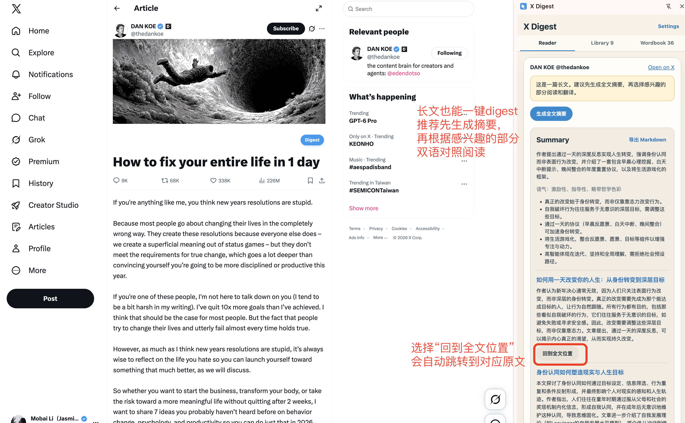
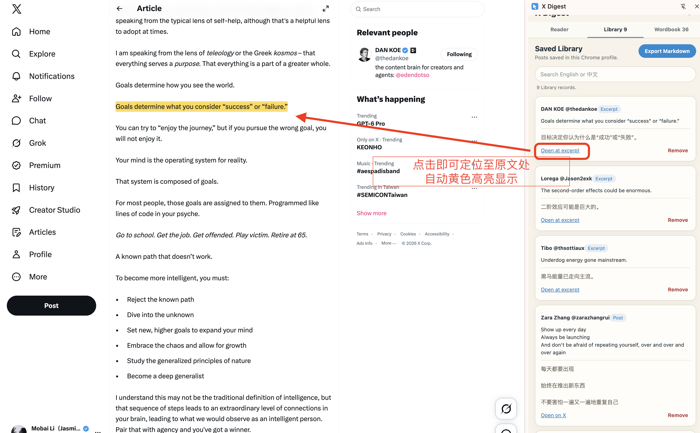

# X Digest

<p align="center"></p>

[English](README.md) · [简体中文](README.zh-CN.md)

**Read X. Keep what matters. Learn the language in context.**

X Digest is a local-first Chrome extension for turning posts and rendered X Articles you are already reading into bilingual reading and English-learning material. Open a post, read an aligned English–Chinese version, summarize a long article, explain an expression in context, or save one useful sentence without collecting your whole timeline.

> **Origin and attribution:** X Digest began as an X-focused remix of [YouTube Digest](https://github.com/zarazhangrui/youtube-digest). Its initial architecture and prompt design were adapted from that MIT-licensed project, and it has since evolved into an independent extension built specifically for X.

## Why X Digest?

X is full of lively, current English—but useful expressions are easy to lose in a fast-moving feed. X Digest keeps the reading experience close to the original post while adding just enough help:

- **Aligned bilingual reading** — English and Chinese appear paragraph by paragraph, not as two disconnected walls of text.
- **Read long Articles with structure** — generate a complete sectioned overview, jump from a section back to its source, then translate only the part you want to study.
- **Explain in context** — select a word or phrase to check naturalness, correction, IPA, meaning, usage, and examples.
- **Save only what matters** — save a whole short post or press `N` to keep just the selected sentence or paragraph.
- **Build a reusable library** — saved posts, excerpts, and wordbook entries stay in the browser and can be exported as Markdown.
- **Bring your own AI key** — AI requests use your DeepSeek API key; X Digest has no application server.

## Current release

This repository is the **P1.5 public beta (`v0.2.0`)**. The core single-post learning loop, rendered Article reading, local bilingual search, reading-position continuity, side-panel lifecycle, and JSON recovery flow have been tested as an unpacked extension on real X pages. X changes its page structure frequently, so edge cases may still appear.

The extension is not yet published in the Chrome Web Store. Install it locally from this repository.

See [the roadmap](docs/ROADMAP.md) for the current boundary and P2 ideas.

### New in v0.2.0

- Search saved Library and Wordbook material in English or Chinese without an AI call.
- Restore the Reader position independently for each long post.
- Close X Digest automatically when the active tab leaves X.
- Export a lossless, schema-versioned JSON backup and merge it back safely later.
- Download a pre-restore safety backup automatically; incompatible legacy AI cache never blocks Library or Wordbook recovery.
- Read rendered X Articles on status pages, up to 100,000 loaded characters.
- Turn long Articles into a sectioned summary, jump to the matching source section, and export the summary with the complete loaded original as Markdown.

## Screenshots


<p align="center">
  
  <br><sub>Turn a long post into a concise overview, tone reading, and key points.</sub>
</p>

<p align="center">
  
  <br><sub>For a long Article, start with a full summary, jump to a useful section, then switch the fixed reading controls to Chinese or bilingual mode.</sub>
</p>

<table>
  <tr>
    <td width="50%" align="center">
      
      <br><sub>Select a word without leaving the post.</sub>
    </td>
    <td width="50%" align="center">
      
      <br><sub>Check naturalness, IPA, meaning, usage, and an example—then save it.</sub>
    </td>
  </tr>
  <tr>
    <td width="50%" align="center">
      
      <br><sub>Keep a whole post or just the excerpt that matters.</sub>
    </td>
    <td width="50%" align="center">
      
      <br><sub>Turn explanations into a reusable local Wordbook.</sub>
    </td>
  </tr>
</table>

<p align="center">
  
  <br><sub>Open a saved excerpt to return to the original sentence; X Digest scrolls it into view and highlights it.</sub>
</p>

<p align="center">
  
  <br><sub>Select a sentence or paragraph and press <code>N</code> to save it to the Library.</sub>
</p>

## Install

### With a coding agent

You can give Codex, Claude Code, or another local coding agent this prompt:

```text
Clone https://github.com/jasminemo1110/x-digest, verify it with npm test,
then show me how to load the folder as an unpacked Chrome extension.
Do not read or modify any API keys.
```

### Manually

```bash
git clone https://github.com/jasminemo1110/x-digest.git
cd x-digest
npm test
```

Then:

1. Open `chrome://extensions`.
2. Turn on **Developer mode**.
3. Choose **Load unpacked**.
4. Select the `x-digest` folder.
5. Open `x.com` and refresh the page.

## Configure DeepSeek

1. Create a key on the [DeepSeek API Keys page](https://platform.deepseek.com/api_keys).
2. Open X Digest settings.
3. Paste the key and save it.

The key is stored in `chrome.storage.local` in your current Chrome profile. Never commit it, paste it into an issue, or include it in a screenshot.

## Use it

1. Click **Digest** beside a rendered post or reply.
2. Switch between **Original**, **中文**, and **Bilingual**.
3. For a long Article, use **Summarize** to generate a sectioned overview. Choose **回到全文位置** on a useful section, then use **中文** or **双语** in the fixed reading controls to translate that section.
4. Select a word or expression, then click the floating **Explain** button.
5. Save the explanation to the Wordbook if it is useful.
6. Use **Save Post** for a whole post, or select an excerpt on X and press `N`.
7. Search **Library** or **Wordbook** locally in English or Chinese.
8. Use **Export Markdown** in an Article Summary to save its overview, section summaries, and complete loaded original. Use **Back up JSON** when you need a restorable copy.
9. In Library, choose **Open at excerpt** to reopen the source at the saved sentence, with an automatic yellow highlight.

## What works today

- Inline Digest actions for currently rendered X posts and replies
- Rendered X Article title and body extraction on status pages, with an explicit 100,000-character coverage limit
- Original, Chinese, and aligned bilingual reading modes
- Long-Article section summaries, source jumps, on-demand section translation, and Summary Markdown export
- DeepSeek-powered translation, summary, and contextual explanation
- Naturalness checks, suggested corrections, IPA for words, usage, and examples
- Whole-post and selected-excerpt bilingual saves
- Local Library and Wordbook with duplicate handling
- Case-insensitive English and literal Chinese search across saved learning material
- Markdown exports for Library, Wordbook, and a complete snapshot
- Lossless JSON backup and non-destructive merge restore; the API key is never exported
- Per-post Reader position restoration for long posts
- Library excerpt source jumps with automatic scroll-to-sentence and yellow highlighting
- Automatic side-panel closing after leaving X
- Clear missing-key, authentication, rate-limit, network, and timeout errors
- One automatic format-only repair attempt for malformed structured AI output
- Warm-up and progress feedback to reduce the perceived delay of a first AI request

## Boundaries

X Digest deliberately does **not** read your X password, session token, official Bookmarks, Likes, private archive, or account history. P1 reads only post content that X has already rendered on the page you are viewing.

It does not currently support automatic bookmark sync, full-timeline collection, Article focus-mode (`/article/...`) pages, semantic Article chapter detection, image OCR, video transcription, Spaces, cloud sync, or background account monitoring.

## Privacy

- No analytics, ads, telemetry, or X API access
- No automatic background collection
- No X Digest backend server
- AI requests happen only after a user action and are sent directly to DeepSeek
- Settings, saved records, and the API key remain in the current Chrome profile
- JSON backups contain learning records, compatible cache, and Reader positions, but never the API key
- Performance logs contain action names and timings, not post text or keys
- Library and Wordbook each retain up to 1,000 records; X Digest warns at 950 records or 90% of Chrome's local storage quota so you can export a complete snapshot before older records are replaced

Read the full [privacy policy](PRIVACY.md) and [security policy](SECURITY.md).

## Make it yours

Forking is welcome. A few possible directions:

- another AI provider;
- another target language;
- Anki or spaced-repetition export;
- Obsidian integration;
- richer thread and reply summaries;
- visual or audio learning support.

Please keep the relevant MIT notices when adapting code or prompts. Bug reports and focused pull requests are welcome; never include private posts, cookies, or API keys in an issue.

## Development

```bash
npm test
```

The extension uses Manifest V3 and has no build step. Load the repository root through `chrome://extensions` → **Developer mode** → **Load unpacked**.

Automated tests do not guarantee compatibility with X's live DOM. Changes to post detection or injection should also be checked on the X home timeline, post detail page, long posts, and visible replies. Public screenshot guidance lives in the [release image checklist](docs/screenshots/README.md).

## The Digest family

From videos and social feeds to your own notes, these projects turn what you are already reading or watching into material you can understand, keep, and learn from:

- [YouTube Digest · my fork](https://github.com/jasminemo1110/youtube-digest): learn from video transcripts, bilingual overviews, and contextual explanations. Forked from [Zara Zhang’s original project](https://github.com/zarazhangrui/youtube-digest).
- [X Digest](https://github.com/jasminemo1110/x-digest): read posts and Articles bilingually, summarize long reads, explain expressions, and save excerpts.
- [Note Digest](https://github.com/jasminemo1110/note-digest): read English Markdown in Obsidian, explain words in context, and save vocabulary and quotes directly to the original note or a separate learning note. It is currently a development build; see its README for installation and API key setup.

Each project installs and runs independently. Learning records and API keys are not automatically shared. If your articles already live in Obsidian, you can use Note Digest directly.

## Acknowledgements

X Digest is grateful to [Zara Zhang's YouTube Digest](https://github.com/zarazhangrui/youtube-digest), whose MIT-licensed architecture and prompt design provided the starting point for this project. See [Third-Party Notices](THIRD_PARTY_NOTICES.md) for the preserved upstream license notice.

## Author

**茉白 Jasmine** — A Japanese-language educator and textbook author learning to build in public through vibe coding, turning teaching experience into practical AI learning tools.

- GitHub: [@jasminemo1110](https://github.com/jasminemo1110)
- X: [@jasminemobai](https://x.com/jasminemobai)
- Other platforms: search **茉白Jasmine**

## License

[MIT](LICENSE) © 2026 茉白 Jasmine
