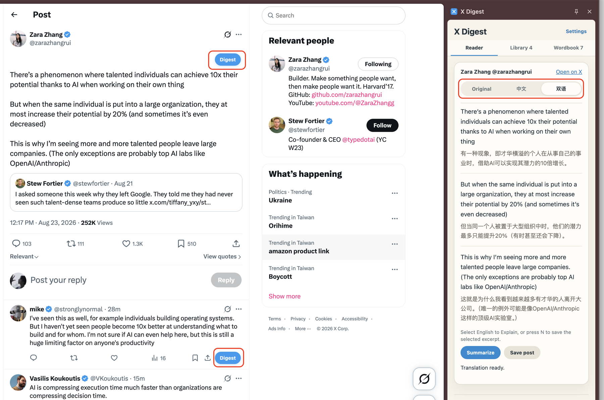
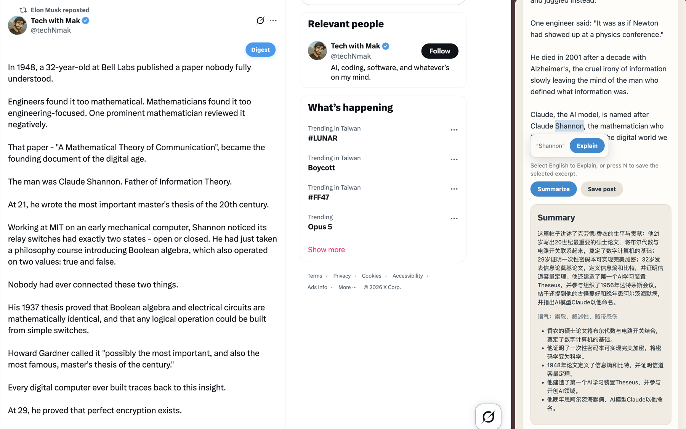
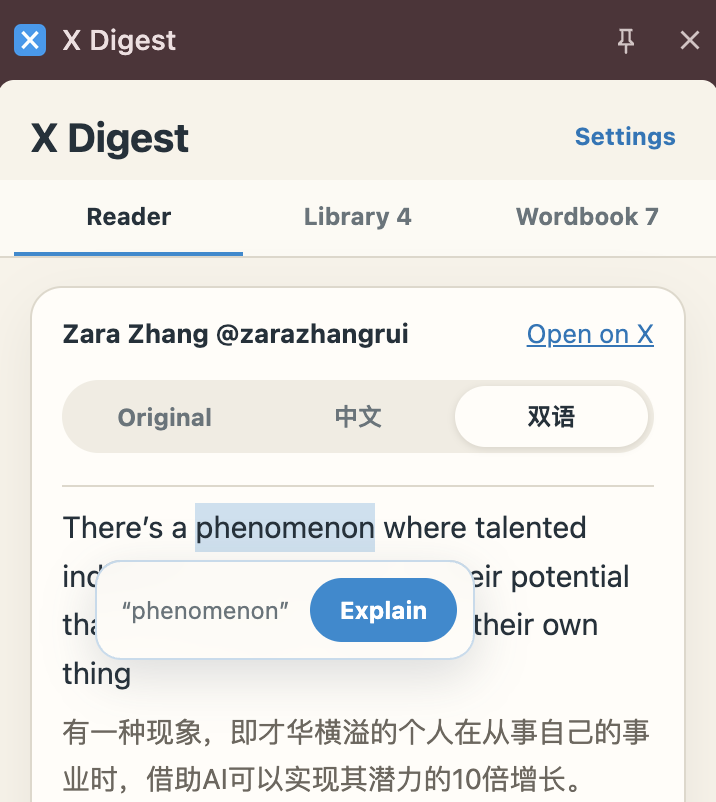
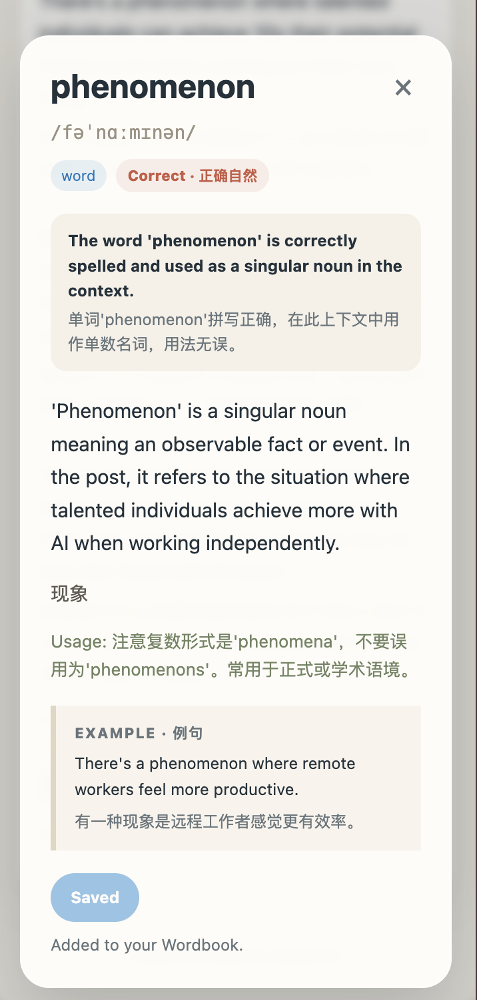
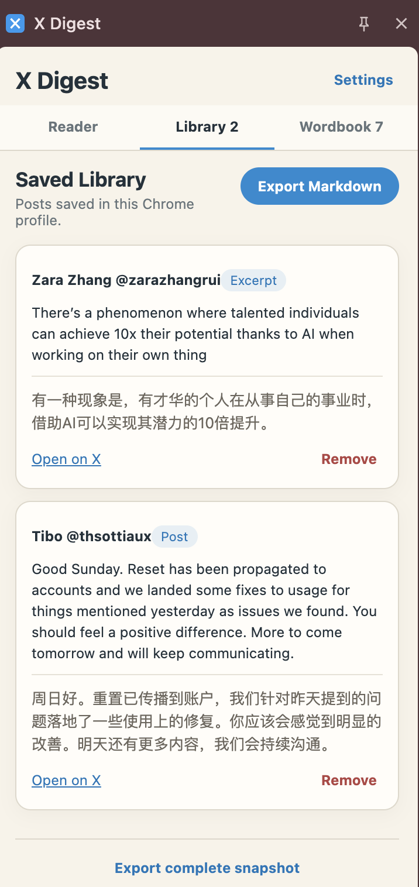
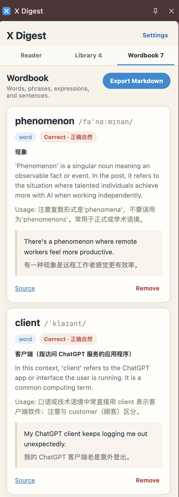
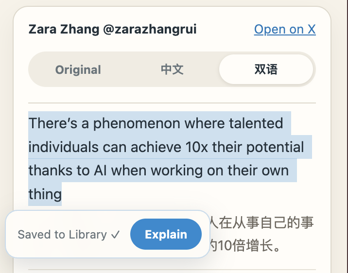

# X Digest

<p align="center"></p>

[English](README.md) · [简体中文](README.zh-CN.md)

**读懂 X，留下真正重要的内容，在语境中学习语言。**

X Digest 是一款本地优先的 Chrome 扩展，把你正在 X 上阅读的推文变成中英双语阅读与英语学习材料。点开一条推文，就可以逐段对照阅读、总结长文、结合上下文解释表达，或者只收藏其中真正值得留下的一句话，而不是收集你的整条时间线。

> **起源与致谢：** X Digest 最初是 [YouTube Digest](https://github.com/zarazhangrui/youtube-digest) 面向 X 场景的复刻与改编项目。初始架构和提示词设计基于该 MIT 开源项目，随后逐步发展为专门服务于 X 的独立扩展。

## 为什么做 X Digest？

X 上有大量鲜活、当下的英语，但在快速滚动的信息流中，值得学习的表达也很容易转眼消失。X Digest 尽量保留原本的阅读体验，只在需要时提供恰到好处的帮助：

- **逐段双语对照**：英文与中文交叉出现，不再是上下两堵互不对应的长文本。
- **总结长推文**：快速抓住重点，同时保留原文供你核对。
- **结合语境解释**：选中单词或短语，查看自然度、建议修正、音标、含义、用法和例句。
- **只收藏真正需要的部分**：短推文可以整条保存；长推文中选中一句或一段，按 `N` 即可收藏。
- **沉淀为可复用的学习库**：推文、摘录和词条保存在浏览器本地，也可以导出为 Markdown。
- **自带 AI Key**：AI 请求使用你自己的 DeepSeek API Key；X Digest 不设应用服务器。

## 当前版本

本仓库目前是 **P1 公开测试版（`v0.1.0`）**。核心的单条推文学习闭环，已经以本地加载扩展的方式，在真实 X 首页、详情页、长推文和回复场景中完成测试。由于 X 会频繁调整页面结构，仍可能出现尚未覆盖的边缘情况。

扩展目前尚未上架 Chrome Web Store，需要从本仓库本地安装。

当前边界和 P2 设想请查看[开发路线图](docs/ROADMAP.md)。

## 截图



<p align="center">
  
  <br><sub>把长推文整理成简明概述、语气判断与关键要点。</sub>
</p>

<table>
  <tr>
    <td width="50%" align="center">
      
      <br><sub>不离开推文，直接选中需要理解的单词。</sub>
    </td>
    <td width="50%" align="center">
      
      <br><sub>确认自然度、音标、含义、用法和例句，并一键收藏。</sub>
    </td>
  </tr>
  <tr>
    <td width="50%" align="center">
      
      <br><sub>可以保留整条推文，也可以只留下真正重要的片段。</sub>
    </td>
    <td width="50%" align="center">
      
      <br><sub>把一次解释沉淀为可以反复使用的本地 Wordbook。</sub>
    </td>
  </tr>
</table>

<p align="center">
  
  <br><sub>选中一句或一段文字，按 <code>N</code> 即可保存到 Library。</sub>
</p>

## 安装

### 让本地编程 Agent 帮你安装

可以把下面这段话交给 Codex、Claude Code 或其他本地编程 Agent：

```text
请克隆 https://github.com/jasminemo1110/x-digest，运行 npm test 完成验证，
然后告诉我怎样把这个文件夹作为“未打包的扩展程序”加载到 Chrome。
不要读取或修改任何 API Key。
```

### 手动安装

```bash
git clone https://github.com/jasminemo1110/x-digest.git
cd x-digest
npm test
```

然后：

1. 打开 `chrome://extensions`。
2. 开启右上角的**开发者模式**。
3. 点击**加载已解压的扩展程序**。
4. 选择 `x-digest` 文件夹。
5. 打开 `x.com` 并刷新页面。

## 配置 DeepSeek

1. 在 [DeepSeek API Keys 页面](https://platform.deepseek.com/api_keys)创建密钥。
2. 打开 X Digest 设置。
3. 填入并保存密钥。

密钥只保存在当前 Chrome Profile 的 `chrome.storage.local` 中。请勿把它提交进代码、粘贴到 Issue，或拍进截图。

## 使用方法

1. 点击已显示推文或回复旁边的 **Digest**。
2. 在 **Original**、**中文**和 **Bilingual** 之间切换。
3. 阅读长推文时使用 **Summarize**。
4. 选中单词或表达，再点击附近悬浮的 **Explain**。
5. 如果解释值得保留，可以将它加入 Wordbook。
6. 用 **Save Post** 收藏整条推文；也可以在 X 上选中一段内容并按 `N`。
7. 在 **Library** 或 **Wordbook** 中复习，并按需导出 Markdown。

## 当前已经支持

- 在当前页面已呈现的 X 推文与回复旁注入 Digest 按钮
- Original、中文和逐段对齐的双语阅读
- 基于 DeepSeek 的翻译、总结与语境解释
- 自然度判断、建议修正、单词音标、用法和例句
- 整条推文与选中摘录的双语收藏
- 浏览器本地 Library 与 Wordbook，以及重复记录处理
- Library、Wordbook 和完整快照的 Markdown 导出
- 缺少 Key、鉴权失败、限流、网络错误与超时的清晰反馈
- AI 结构化结果异常时，自动进行一次只修复格式的请求
- 首次 AI 请求的预热与即时进度反馈

## 产品边界

X Digest 不会读取你的 X 密码、登录令牌、官方书签、点赞、私人归档或账号历史。P1 只读取 X 已经呈现在当前页面上的推文内容。

目前暂不支持官方书签同步、全时间线收集、X Articles、图片 OCR、视频转录、Spaces、云同步或后台账号监控。

## 隐私

- 不含数据分析、广告、遥测或 X API 调用
- 不会在后台自动收集内容
- 没有 X Digest 后端服务器
- 只有用户主动操作后，相关 AI 请求才会直接发送给 DeepSeek
- 设置、收藏记录和 API Key 保留在当前 Chrome Profile 中
- 性能日志只记录操作名称和耗时，不记录推文文字或 Key

详细内容请查看[隐私政策](PRIVACY.md)和[安全政策](SECURITY.md)。

## Fork 成你自己的版本

欢迎 Fork。你可以继续探索：

- 接入其他 AI Provider；
- 换成其他目标语言；
- 导出到 Anki 或加入间隔复习；
- 接入 Obsidian；
- 丰富 Thread 和回复总结；
- 加入图像或音频学习能力。

改编代码或提示词时，请保留相关 MIT 声明。欢迎提交 Bug 和范围清晰的 Pull Request；请勿在 Issue 中包含私人推文、Cookie 或 API Key。

## 开发

```bash
npm test
```

本扩展使用 Manifest V3，不需要构建步骤。可以直接在 `chrome://extensions` → **开发者模式** → **加载已解压的扩展程序**中选择仓库根目录。

自动化测试不等于对 X 实时 DOM 的兼容保证。修改推文识别或按钮注入逻辑后，还需要在 X 首页、推文详情页、长推文和可见回复中手动验证。公开截图规范请查看[发布图片检查清单](docs/screenshots/README.md)。

## 致谢

感谢 [Zara Zhang 的 YouTube Digest](https://github.com/zarazhangrui/youtube-digest)。它的 MIT 开源架构与提示词设计为本项目提供了起点。完整保留的上游许可声明请查看[第三方声明](THIRD_PARTY_NOTICES.md)。

## 作者

**茉白 Jasmine** — 日语教师与教材作者出身，从零开始学习 vibe coding，正在把语言教学经验变成真正可用的 AI 学习工具。

- GitHub：[@jasminemo1110](https://github.com/jasminemo1110)
- X：[@jasminemobai](https://x.com/jasminemobai)
- 其他平台：搜索 **茉白Jasmine**

## 许可证

[MIT](LICENSE) © 2026 茉白 Jasmine
